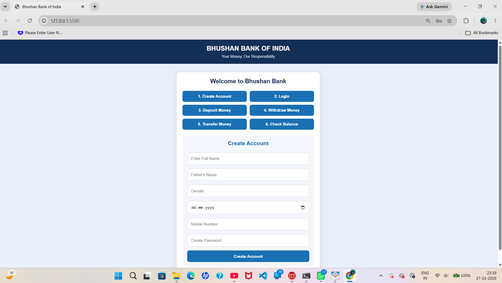
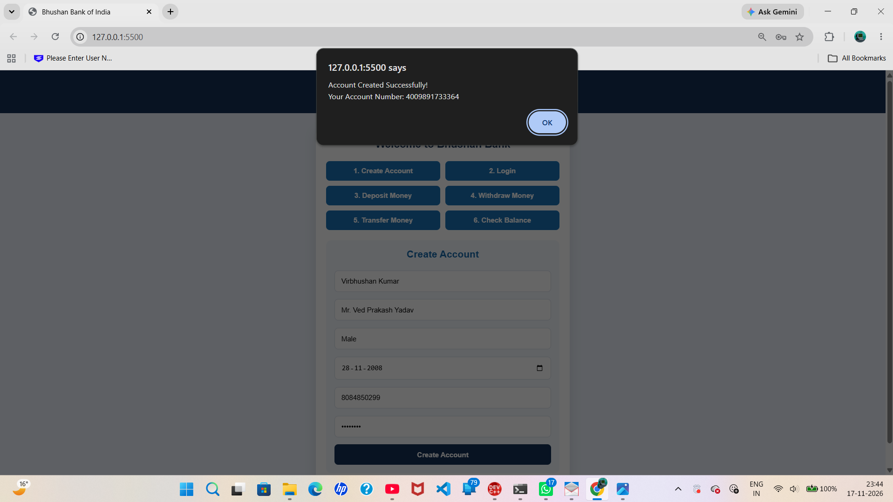
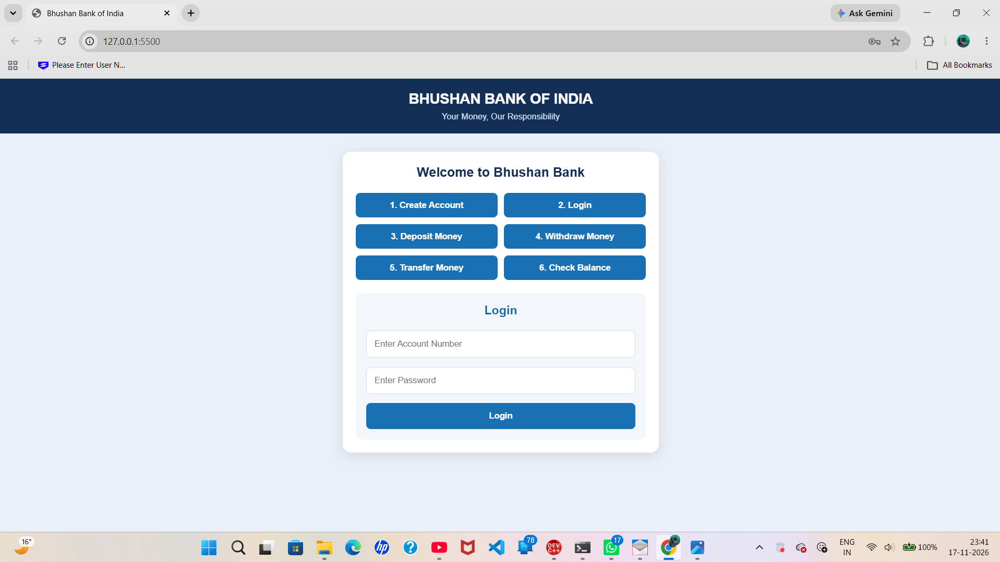
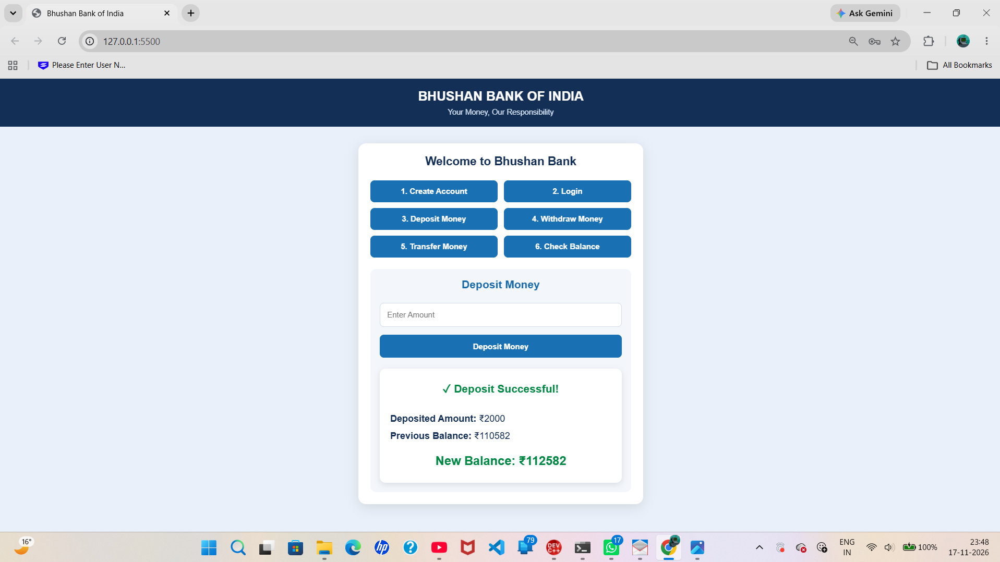
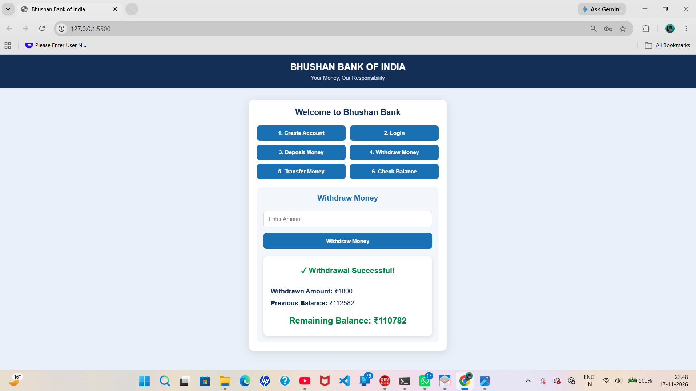
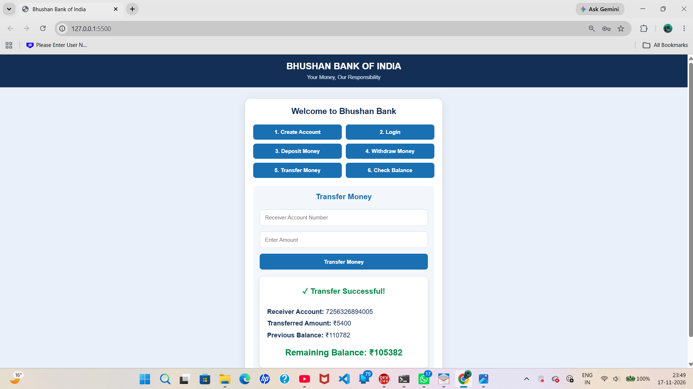
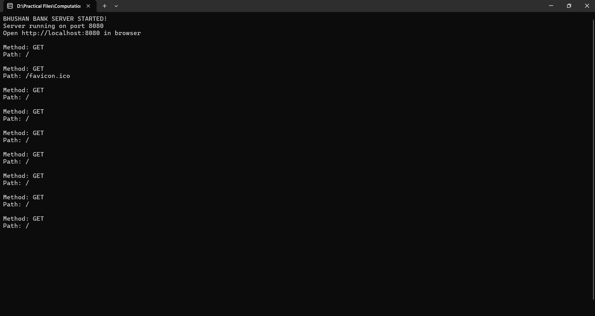

# 🏦 BHUSHAN BANK OF INDIA

### Your Money, Our Responsibility.

A simple Banking Management System developed using C, HTML, CSS and JavaScript.

The project demonstrates basic banking operations through a user-friendly interface and a C-based banking program.

---

## 📌 About the Project

Bhushan Bank of India is an educational Banking Management System project designed to demonstrate basic banking operations and programming concepts.

It provides a simple interface where users can explore account management and banking transactions.

## ✨ Features

- 👤 Create a New Bank Account
- 🔐 User Login System
- 💰 Deposit Money
- 💸 Withdraw Money
- 🔄 Transfer Money
- 📊 Check Account Balance
- 🖥️ Interactive Banking Interface
- 💾 Browser-based Data Storage

## 🛠️ Technologies Used

| Technology | Purpose |
|---|---|
| C | Banking program and server prototype |
| HTML5 | Webpage structure |
| CSS3 | User interface design |
| JavaScript | Banking interface functionality |
| Git & GitHub | Version control and project hosting |

## 📂 Project Structure

```text
BHUSHAN-BANK-OF-INDIA/
│
├── bank.c
├── server.c
├── index.html
├── style.css
├── script.js
└── README.md
```

## 🚀 How to Run

### Web Interface

1. Download or clone this repository.
2. Open the project folder in VS Code.
3. Open `index.html`.
4. Run it using Live Server or open it in a browser.

### C Programs

The repository also contains C source files for the banking program and a basic server prototype.

Use a suitable C compiler to build and test these programs.

## ⚠️ Important Notice

This project is developed for educational and demonstration purposes only.

The browser version uses localStorage for storing account information. It is not a secure banking platform and should not be used for real financial transactions or personal banking information.

The C server is currently a basic server prototype, not a production banking API.

## 🎯 Project Objective

The main objective is to understand:

- Basic Banking Management
- C Programming
- HTML, CSS and JavaScript
- User Interface Development
- Basic Client-Server Concepts
- Git and GitHub

## 👨‍💻 Developer

**Virbhushan Kumar**

Project: Bhushan Bank of India

---

### ⭐ Thank You for Visiting!

If you find this project interesting, consider giving it a star on GitHub.


---

## 📸 Project Screenshots

### 🏦 Banking Dashboard


### 📝 Create Account


### 🔐 Login Page


### 💰 Deposit Money


### 💸 Withdraw Money


### 🔄 Transfer Money


### 🖥️ Server Console


---
